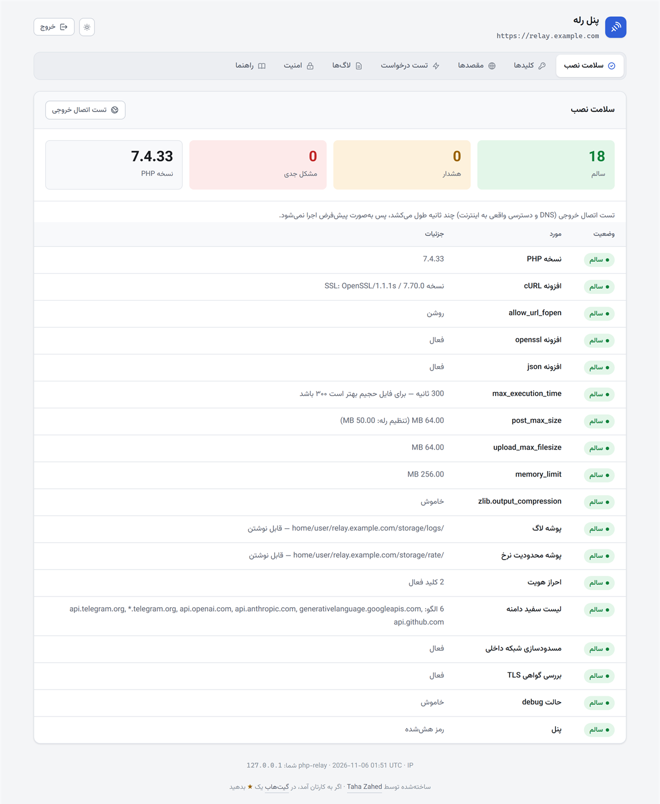
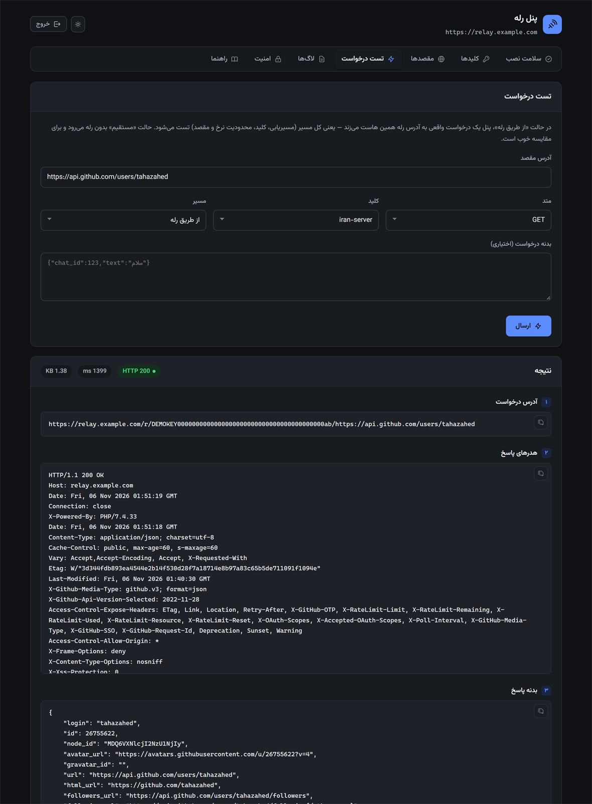
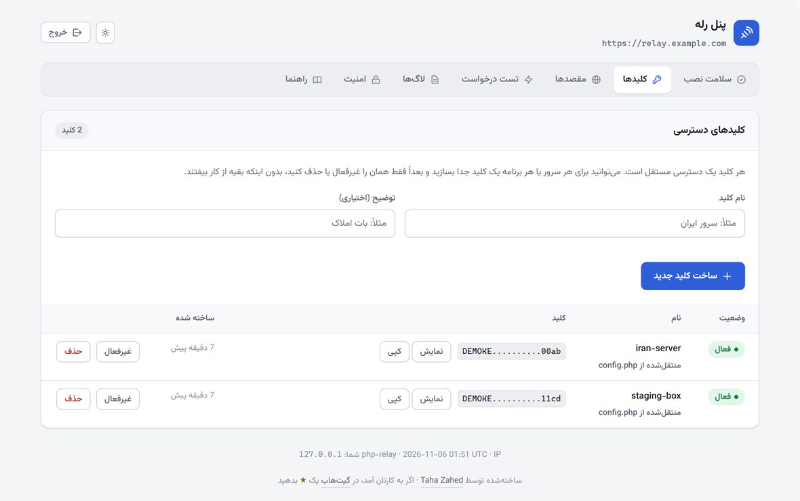
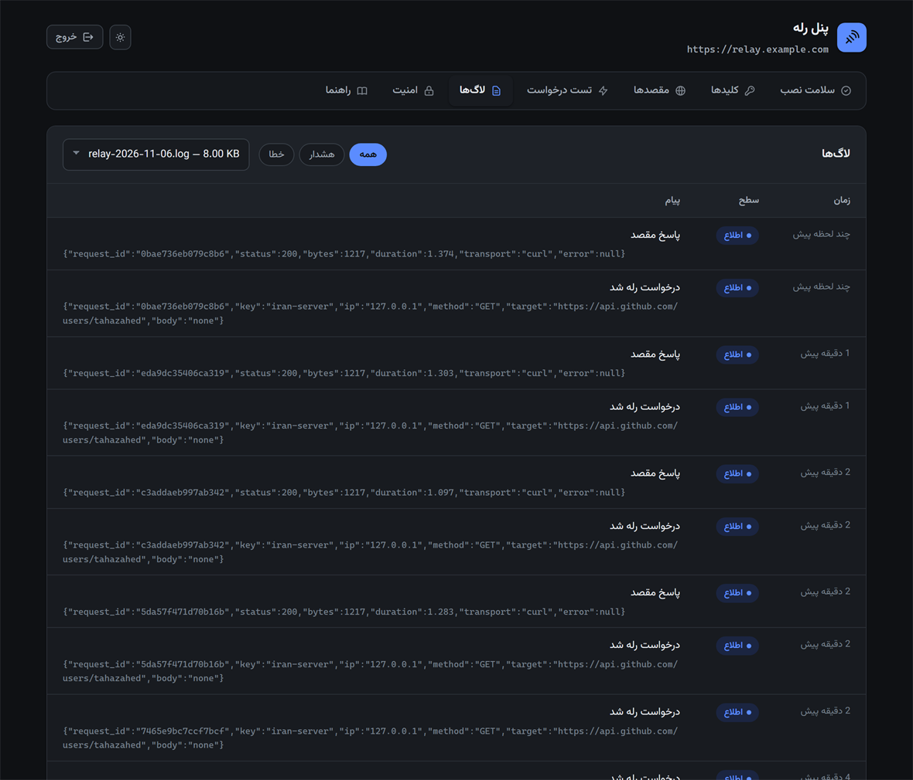

<div align="center">

# PHP Relay Proxy

**یک رله‌ی HTTP که روی هر هاست اشتراکی cPanel یا DirectAdmin بالا می‌آید.**
بدون Composer، بدون root، بدون داکر، بدون هیچ سرویس دائمی — چند تا فایل PHP داخل `public_html`.

[](https://www.php.net/)
[](LICENSE)
[](#no-composer)
[](#webserver)

[English](README.md) · [راهنمای نصب روی cPanel](docs/deployment-cpanel.md) · [گزارش مشکل امنیتی](SECURITY.md)

</div>

---

## قصه از کجا شروع شد

یک بات تلگرام دارم که کدش روی هاست ایران است، چون دیتابیس و بقیه‌ی برنامه از اول همان‌جا
بودند. مشکل اینجاست که `api.telegram.org` از داخل ایران بالا نمی‌آید. یعنی هر فراخوانی
API — `getMe`، `sendMessage`، `sendPhoto` — بعد از چند ثانیه با تایم‌اوت برمی‌گردد.

کل برنامه را ببرم خارج؟ به‌خاطر دیتابیس و سرعت کاربر ایرانی نمی‌صرفید. VPN یا پروکسی
SOCKS روی هاست اشتراکی هم که اصلاً شدنی نیست: نه root داریم، نه اجازه‌ی بالا نگه داشتن
یک سرویس.

چیزی که دم دستم بود یک هاست cPanel ارزان روی سرور آلمان بود. این پروژه همان وسط
می‌نشیند: درخواست را از سرور ایران تحویل می‌گیرد، از طرف خودش به مقصد واقعی می‌زند، و
جواب را همان‌طور که گرفته برمی‌گرداند — بایت به بایت، با همان هدرها و همان کد وضعیت.

```
┌──────────────────┐                                    ┌──────────────────┐
│   سرور شما       │                                    │      مقصد        │
│   (فیلتر شده)    │                                    │ api.telegram.org │
└────────┬─────────┘                                    └────────▲─────────┘
         │                                                       │
         │  GET https://relay.example.com/r/KEY/                  │
         │      https://api.telegram.org/bot<TOKEN>/getMe         │
         │                                                       │
         │              ┌──────────────────────────┐             │
         └─────────────►│   همین اسکریپت، روی      │─────────────┘
                        │   هاستی که فیلتر نیست     │
         ◄──────────────│         (cPanel)          │◄─────────────
            جواب        └──────────────────────────┘      جواب
         دست‌نخورده                                     دست‌نخورده
```

در کد برنامه فقط یک خط عوض می‌شود: آدرس پایه‌ی API. کتابخانه‌ی بات، بدنه‌ی درخواست‌ها،
آپلود فایل — همه سر جایشان می‌مانند.

<div align="center">
  
  <br>
  <sub>تب «سلامت نصب» روی یک نصب تازه.</sub>
</div>

---

## کجاها به درد می‌خورد

کاری که رله می‌کند عمداً ساده است: درخواستی را که سرور شما نمی‌تواند بزند، از جای دیگری
می‌زند. چیزی که بین مثال‌های زیر فرق می‌کند فقط *جای وصل شدن* است — یک آدرس پایه، یک
فیلتر فریم‌ورک، یا یک میدل‌ور Guzzle.

همه‌ی این مثال‌ها قبل از اینکه اینجا بنویسمشان، با همین کد و روی مقصد واقعی تست شده‌اند.

### باتی که کدش جایی نمی‌رود

آدرس پایه‌ی API را بدهید به رله:

```php
// قبل — از ایران تایم‌اوت می‌شود
$api = 'https://api.telegram.org';

// بعد — از رله رد می‌شود
$api = 'https://relay.example.com/r/' . RELAY_KEY . '/https://api.telegram.org';
```

همین. از این به بعد همه‌ی متدها کار می‌کنند، آپلود فایل هم:

```php
// sendPhoto با آپلود واقعی multipart، از همان مسیر رله
$response = relay_request(
    "https://api.telegram.org/bot{$token}/sendPhoto",
    'POST',
    [
        'chat_id' => 123456789,
        'caption' => 'آپلود از طریق رله',
        'photo'   => new CURLFile(__DIR__ . '/sample.jpg', 'image/jpeg', 'sample.jpg'),
    ]
);
```

تقریباً همه‌ی کتابخانه‌های بات اجازه می‌دهند آدرس پایه را خودتان ست کنید، پس لازم نیست
داخل کد کتابخانه دست ببرید. در python-telegram-bot اسمش `base_url` است، در Telegraf
`telegram.apiRoot`، و در `irazasyed/telegram-bot-sdk` کلید `base_bot_url`.

دانلود فایل در تلگرام مسیر جدایی دارد، پس آدرسش هم جداست:

```
https://relay.example.com/r/<KEY>/https://api.telegram.org/file/bot<TOKEN>/<file_path>
```

**سر آپدیت‌های ورودی یک نکته هست.** خود تلگرام فیلتر نیست؛ *سرور شماست* که نمی‌تواند
بیرون برود. پس برای مسیر برگشت دو انتخاب دارید:

- **`getUpdates`** — راحت‌ترین راه. درخواست از سمت خودتان شروع می‌شود، از رله رد می‌شود و
  تلگرام جواب می‌دهد. نه وبهوک می‌خواهد نه دامنه‌ی عمومی. فقط حواستان باشد تایم‌اوت
  کلاینت را بیشتر از تایم‌اوت خود تلگرام بگذارید (۶۵ ثانیه در برابر poll شصت‌ثانیه‌ای).
- **وبهوک** — اگر دامنه‌ی ایرانی‌تان از بیرون در دسترس است، `setWebhook` را روی همان
  تنظیم کنید. تلگرام خودش به شما وصل می‌شود و فقط همان یک فراخوانی `setWebhook` باید از
  رله رد شود.

نمونه‌ی کامل هر دو حالت در [`clients/telegram-webhook.php`](clients/telegram-webhook.php)
هست. آن فایل روی سرور *خودتان* می‌رود، نه روی رله.

### API مدل‌های زبانی: OpenAI و Claude و Gemini

همان الگو، مقصد عوض. دامنه را به لیست سفید اضافه کنید و آدرس پایه را بچرخانید:

```bash
curl "https://relay.example.com/r/<KEY>/https://api.openai.com/v1/chat/completions" \
     -H "Authorization: Bearer sk-..." \
     -H "Content-Type: application/json" \
     -d '{"model":"gpt-4o-mini","messages":[{"role":"user","content":"سلام"}]}'
```

جواب استریمی (`"stream": true`) هم مشکلی ندارد، چون رله بدنه را تکه‌تکه بیرون می‌دهد و
در حافظه تلنبار نمی‌کند. دانلود یک‌گیگابایتی هم حافظه را پر نمی‌کند.

### سایت وردپرسی، بدون دست زدن به کد افزونه‌ها

این همان حالتی است که نمی‌شود تک‌تک جاهای فراخوانی را عوض کرد، چون درخواست‌ها وسط
قالب‌ها و افزونه‌هایی‌اند که خودتان ننوشته‌اید. خوشبختانه وردپرس همه را از یک HTTP API
رد می‌کند، پس با یک افزونه‌ی must-use می‌شود کل مسیر را منحرف کرد.

این را به اسم `wp-content/mu-plugins/relay.php` ذخیره کنید؛ جای دیگری لازم نیست دست بزنید:

```php
<?php
// wp-content/mu-plugins/relay.php — قبل از افزونه‌های معمولی لود می‌شود و غیرفعال هم نمی‌شود

const RELAY_BASE  = 'https://relay.example.com';
const RELAY_KEY   = 'کلید-شما';
const RELAY_HOSTS = ['api.telegram.org', 'api.openai.com', 'www.google.com'];

add_filter('pre_http_request', static function ($preempt, $args, $url) {
    static $busy = false;

    // درخواستی که پایین می‌زنیم دوباره وارد همین فیلتر می‌شود؛ این فلگ جلوی حلقه را می‌گیرد
    if ($busy || !in_array(parse_url($url, PHP_URL_HOST), RELAY_HOSTS, true)) {
        return $preempt;
    }

    $busy   = true;
    $result = wp_remote_request(RELAY_BASE . '/r/' . RELAY_KEY . '/' . $url, $args);
    $busy   = false;

    return $result;
}, 10, 3);
```

وقتی `pre_http_request` یک آرایه‌ی پاسخ برگرداند، وردپرس دیگر درخواست خودش را نمی‌زند.
یعنی افزونه‌ها یک نتیجه‌ی عادی `wp_remote_*` می‌گیرند و اصلاً خبردار نمی‌شوند که وسط کار
رله‌ای بوده.

### لاراول و Guzzle: یک میدل‌ور، بدون عوض کردن جای فراخوانی

همان ایده، فریم‌ورک دیگر. یک میدل‌ور `mapRequest` آدرس هر درخواستی را که به مقصد فیلترشده
می‌رود بازنویسی می‌کند:

```php
use GuzzleHttp\Client;
use GuzzleHttp\HandlerStack;
use GuzzleHttp\Middleware;
use GuzzleHttp\Psr7\Uri;
use Psr\Http\Message\RequestInterface;

$relayed = ['api.openai.com', 'api.telegram.org', 'api.stripe.com'];

$stack = HandlerStack::create();

$stack->push(Middleware::mapRequest(function (RequestInterface $request) use ($relayed) {
    if (!in_array($request->getUri()->getHost(), $relayed, true)) {
        return $request;
    }

    return $request->withUri(new Uri(
        config('relay.base') . '/r/' . config('relay.key') . '/' . $request->getUri()
    ));
}));

$client = new Client(['handler' => $stack]);
```

`withUri()` به‌صورت پیش‌فرض هدر `Host` را هم روی رله ست می‌کند، که دقیقاً همان چیزی است
که اینجا می‌خواهیم. در لاراول همین stack را به کلاینت HTTP بدهید:

```php
Http::withOptions(['handler' => $stack])->post('https://api.openai.com/v1/chat/completions', $payload);
```

### نوتیفیکیشن پوش با Firebase

نکته‌ای که معمولاً از قلم می‌افتد: اینجا **دو** دامنه باید در لیست سفید باشد، نه یکی.
گرفتن توکن و فرستادن پیام دو سرویس جدای گوگل‌اند:

```
oauth2.googleapis.com     ← توکن دسترسی را از روی JWT سرویس‌اکانت می‌دهد
fcm.googleapis.com        ← خود نوتیفیکیشن را می‌فرستد
```

```bash
# ۱) گرفتن توکن دسترسی
curl "https://relay.example.com/r/<KEY>/https://oauth2.googleapis.com/token" \
     -d "grant_type=urn:ietf:params:oauth:grant-type:jwt-bearer&assertion=<SIGNED_JWT>"

# ۲) فرستادن به دستگاه
curl "https://relay.example.com/r/<KEY>/https://fcm.googleapis.com/v1/projects/<PROJECT>/messages:send" \
     -H "Authorization: Bearer <ACCESS_TOKEN>" \
     -H "Content-Type: application/json" \
     -d '{"message":{"token":"<DEVICE>","notification":{"title":"سلام","body":"یک پیام تازه"}}}'
```

دونقطه‌ی وسط `messages:send` سالم رد می‌شود، فارسی داخل JSON هم همین‌طور — بدنه‌ی یونیکد
بایت‌به‌بایت آن طرف در می‌آید.

### اعتبارسنجی reCAPTCHA از سمت سرور

فرم تماس روی سرور فیلترشده نمی‌تواند کپچای خودش را چک کند، چون آن چک یک POST
سرور-به-سرور به گوگل است که تایم‌اوت می‌شود. نتیجه‌اش هم معمولاً یکی از این دوتاست: یا
فرم همه‌ی ارسال‌های درست را رد می‌کند، یا کسی می‌آید اعتبارسنجی را کلاً خاموش می‌کند که
دیگر اصلاً فایده‌ی کپچا از بین می‌رود.

```bash
curl -X POST "https://relay.example.com/r/<KEY>/https://www.google.com/recaptcha/api/siteverify" \
     -d "secret=<SECRET>&response=<TOKEN_FROM_BROWSER>&remoteip=<USER_IP>"
```

`www.google.com` را به لیست سفید اضافه کنید و فرم دوباره راه می‌افتد.

**یک نکته را رک بگویم:** این فقط نصفه‌ی سمت سرور را درست می‌کند. مرورگر بازدیدکننده هم
باید بتواند خود ویجت reCAPTCHA را لود کند. اگر کاربرهای شما هم پشت فیلترند، رله‌ی
سمت سرور به دردشان نمی‌خورد و باید سراغ کپچایی بروید که برایشان بالا می‌آید.

### درگاه پرداخت، پیامک و ایمیل

همه از یک الگو: دامنه را به لیست سفید اضافه کنید، رله را جلوی آدرس پایه بگذارید.

| سرویس | دامنه‌ای که باید مجاز شود |
|---|---|
| Stripe | `api.stripe.com` |
| PayPal | `api-m.paypal.com` |
| Twilio | `api.twilio.com` |
| SendGrid | `api.sendgrid.com` |
| Mailgun | `api.mailgun.net` |

**وبهوک‌ها داستان جداست.** رله کاری می‌کند که *شما* بتوانید بیرون بزنید. اینکه سرویس
بخواهد به *شما* زنگ بزند و بگوید پرداخت انجام شد، همچنان نیاز دارد سرورتان از اینترنت
در دسترس باشد — وگرنه باید وضعیت را خودتان poll کنید، دقیقاً همان دوراهی `getUpdates` و
وبهوک در تلگرام.

### نگه داشتن کلید API بیرون از سرور برنامه

اگر روزی سرور ایرانی‌تان هک شود، هر کلید API که داخل کدش باشد هم لو می‌رود. می‌شود کلید
را به‌جای آن روی رله نگه داشت:

```php
// config.php، فقط روی رله
'http' => [
    'extra_request_headers' => [
        'Authorization' => 'Bearer sk-proj-...',
    ],
],
```

حالا سرور برنامه درخواست را بدون کلید می‌فرستد و رله موقع خروج خودش اضافه‌اش می‌کند.
چیزی که دست برنامه است فقط کلید رله است، و آن را با دو کلیک از پنل باطل می‌کنید بدون
اینکه به حساب سرویس اصلی دست بزنید.

### گیت‌هاب و Composer و npm

```bash
curl "https://relay.example.com/r/<KEY>/https://api.github.com/repos/laravel/laravel/releases/latest"
```

برای چک کردن آپدیت، اسکریپت‌های CI و سرورهای لایسنس روی ماشین‌هایی که مستقیم به
`api.github.com` یا `registry.npmjs.org` نمی‌رسند.

### جایی که این روش دیگر جواب نمی‌دهد

بهتر است قبل از اینکه چیزی روی این بنا کنید بدانید:

- **وب‌سوکت کار نمی‌کند.** یک اسکریپت PHP روی هاست اشتراکی نمی‌تواند یک اتصال دوطرفه را
  باز نگه دارد. راه‌حل جایگزینی هم ندارد؛ برای این کار باید نوع هاست را عوض کنید.
- **ترافیک ورودی را پوشش نمی‌دهد.** این یک رله‌ی خروجی است. هر چیزی که باید به *شما*
  برسد — وبهوک، کال‌بک، ریدایرکت OAuth — همچنان سرور در دسترس می‌خواهد، یا باید طراحی را
  روی polling ببرید.
- **امضاهایی که به Host گره خورده‌اند را حتماً تست کنید.** روش‌هایی که هدر `Host` یا کل
  آدرس را امضا می‌کنند — معروف‌ترینش AWS Signature V4 — به دوباره‌فرستاده‌شدن درخواست
  حساس‌اند. قبل از اینکه رویش حساب کنید، با سرویس خودتان امتحانش کنید.
- **فیلتر بودن سمت مرورگر مسئله‌ی دیگری است.** اگر بازدیدکننده‌ی شما نمی‌تواند یک اسکریپت
  یا ویجت را لود کند، رله کردن درخواست‌های سرور چیزی را برایش عوض نمی‌کند.
- **یک hop اضافه می‌شود.** روی هر فراخوانی، رفت‌وبرگشت تا هاست رله را هم حساب کنید.

---

## چه چیزهایی پشتیبانی می‌شود

| مورد | وضعیت |
|---|---|
| همه‌ی متدهای HTTP (`GET`/`POST`/`PUT`/`PATCH`/`DELETE`/`HEAD`/`OPTIONS`) | ✅ |
| بدنه‌ی JSON، فرم و باینری خام، بایت‌به‌بایت | ✅ |
| آپلود `multipart/form-data` (مثل `sendPhoto` و `sendDocument`) | ✅ |
| آپلود حجیم به‌صورت استریم، بدون پر کردن حافظه | ✅ |
| دانلود حجیم به‌صورت استریم و تکه‌تکه | ✅ |
| بدنه‌ی `Transfer-Encoding: chunked` | ✅ |
| رد کردن عین هدرها و کد وضعیت | ✅ |
| دنبال کردن ریدایرکت، با چک شدن دوباره‌ی هر hop | ✅ |
| احراز هویت با کلید ثابت یا امضای HMAC | ✅ |
| لیست سفید دامنه، محدودیت نرخ، لاگ، CORS | ✅ |
| محافظت SSRF (بستن شبکه‌ی داخلی و پین کردن IP) | ✅ |
| پنل مدیریت با تست درخواست زنده و نمایش لاگ | ✅ |
| کار کردن بدون افزونه‌ی cURL (با stream wrapper) | ✅ |
| WebSocket | ❌ با PHP روی هاست اشتراکی شدنی نیست |

---

## چه چیزهایی لازم دارید

- PHP نسخه‌ی ۷.۴ به بالا. CI در هر push سینتکس را روی ۷.۴ و ۸.۰ و ۸.۱ و ۸.۲ و ۸.۳ چک
  می‌کند؛ نصبی که خودم هر روز باهاش کار می‌کنم روی ۸.۱ است.
- افزونه‌ی `curl`. اجباری نیست ولی خیلی بهتر است؛ بدون آن رله می‌افتد روی stream wrapper
  که کندتر است و `allow_url_fopen` می‌خواهد.
- `openssl` و `json`
- یک هاست که گرفتار همان فیلترینگ سرور برنامه‌تان نباشد
- اجازه‌ی نوشتن روی `storage/logs` و `storage/rate`

همین. نه شل می‌خواهد، نه کران‌جاب، نه Composer، نه دیتابیس.

---

## نصب، قدم به قدم

اگر تا حالا چیزی را دستی روی هاست نگذاشته‌اید، همه‌ی قدم‌ها را بخوانید. اگر عجله دارید،
قدم‌های ۱ و ۲ و ۴ و ۷ آن‌هایی‌اند که واقعاً مهم‌اند.

### قدم ۱ — یک هاست که فیلتر نباشد

هر هاست اشتراکی cPanel یا DirectAdmin خارج از کشور کافی است؛ لازم نیست VPS بگیرید. یک
دامنه یا ساب‌دامنه مثل `relay.yourdomain.com` بهش وصل کنید و بگذارید خود پنل گواهی رایگان
Let's Encrypt / AutoSSL بگیرد. **حتماً روی HTTPS** — چون کلید رله داخل خود آدرس می‌رود و
روی HTTP ساده لو می‌رود.

### قدم ۲ — فایل‌ها را آپلود کنید

ریپو را دانلود کنید (دکمه‌ی سبز **Code** ← **Download ZIP**). بعد در cPanel برویدسراغ
**File Manager**، وارد document root ساب‌دامنه شوید، فایل ZIP را آپلود کنید و از
راست‌کلیک بزنید **Extract**.

آخرش باید این شکلی شده باشد:

```
public_html/              ← document root دامنه‌ی relay.yourdomain.com
├── index.php             ← نقطه‌ی ورود؛ هر درخواست رله اینجا می‌آید
├── panel.php             ← پنل مدیریت
├── bootstrap.php
├── config.php            ← در قدم ۳ خودتان می‌سازید
├── config.sample.php
├── .htaccess
├── src/                  ← بدنه‌ی اصلی کد
├── tools/                ← ساخت کلید و تست سلامت
├── clients/              ← نمونه کد برای سرور شما، نه برای رله
├── assets/               ← فونت پنل
└── storage/
    ├── logs/
    └── rate/
```

پوشه‌ی `docs/` و فایل‌های README لازم نیست آپلود شوند، هرچند ضرری هم ندارند.

### قدم ۳ — فایل `config.php` را بسازید

در File Manager روی `config.sample.php` راست‌کلیک کنید ← **Copy**، و اسم کپی را بگذارید
`config.php`. توضیح تک‌تک تنظیم‌ها داخل خود همان فایل نوشته شده.

> **یک راه امن‌تر هم هست.** اگر می‌توانید یک پوشه بالاتر از document root دایرکتوری
> بسازید، فایل را بگذارید در `../relay-private/config.php`؛ `bootstrap.php` اول همان‌جا
> را نگاه می‌کند. چرا؟ چون اگر یک روز هندلر PHP هاست خراب شود، `config.php` داخل
> document root به‌صورت متن خام سرو می‌شود — با همه‌ی کلیدهایتان. بیرون از web root
> چنین اتفاقی نمی‌افتد.

### قدم ۴ — کلید و هش رمز بسازید

اگر SSH یا Terminal در cPanel دارید:

```bash
php tools/keygen.php "رمزی-که-برای-پنل-می‌خواهید"
```

این یک کلید دسترسی، یک کلید HMAC و هش bcrypt رمز پنل را چاپ می‌کند.

ترمینال ندارید؟ `https://relay.yourdomain.com/panel.php` را باز کنید، با رمز موقتی که
داخل `config.php` هست وارد شوید و از تب **کلیدها** استفاده کنید؛ خودش کلید می‌سازد. برای
هش رمز هم تب **امنیت** بدون هیچ خط فرمانی کار را راه می‌اندازد.

### قدم ۵ — `config.php` را ویرایش کنید

چهار چیز مهم است، بقیه مقدار پیش‌فرض درست‌وحسابی دارند.

```php
'auth' => [
    'keys' => [
        // برای هر کلاینت یک کلید جدا، تا بعداً بتوانید تکی باطلشان کنید
        'my-server' => 'کلید-قدم-۴',
    ],
],

'target' => [
    // فقط دامنه‌هایی که واقعاً لازم دارید. این را هیچ‌وقت خالی نگذارید.
    'host_allowlist' => ['api.telegram.org', '*.telegram.org'],
],

'panel' => [
    'password_hash' => 'هش-قدم-۴',
    'password'      => '',   // بعد از ست کردن هش، این خالی بماند
],

'app' => ['debug' => false],
```

### قدم ۶ — دسترسی پوشه‌ها

`storage/logs` و `storage/rate` باید قابل نوشتن باشند. معمولاً `755` جواب می‌دهد؛ اگر لاگ
خالی ماند، `775` را امتحان کنید.

### قدم ۷ — نصب را چک کنید

`https://relay.yourdomain.com/panel.php` را باز کنید و بروید تب **سلامت نصب**. همه‌ی
ردیف‌ها باید سبز باشند. هر چیزی که FAIL است را قبل از استفاده‌ی جدی درست کنید.

از خط فرمان، همین چک این است:

```bash
php tools/selftest.php
```

بعد از تب **تست درخواست** یک درخواست واقعی بفرستید و جواب را ببینید:

<div align="center">
  
  <br>
  <sub>یک درخواست واقعی از مسیر رله — کد وضعیت، زمان، هدرهای پاسخ و بدنه.</sub>
</div>

### قدم ۸ — برنامه را وصل کنید

آدرس پایه‌ی API را در برنامه‌تان عوض کنید، همان‌طور که بالا دیدید. فایل
[`clients/php-client.php`](clients/php-client.php) یک wrapper آماده است که می‌توانید
برش دارید.

---

## چهار شکل آدرس دادن

چهار راه برای گفتن «این را رله کن» وجود دارد. کارشان یکی است؛ هرکدام با کتابخانه‌ی شما
جور در آمد را بردارید.

### کلید داخل مسیر (پیشنهاد من)

```
https://relay.example.com/r/<KEY>/https://api.telegram.org/bot<TOKEN>/getMe
```

تنها حالتی است که با کتابخانه‌هایی که اجازه‌ی اضافه کردن هدر نمی‌دهند هم کار می‌کند.

> آدرس مقصد **باید** با `https://` یا `http://` شروع شود. بدون پروتکل، اسکریپت نمی‌فهمد
> کلید کجا تمام شده و مقصد از کجا شروع می‌شود.

### کلید در هدر

```bash
curl "https://relay.example.com/r/https://api.telegram.org/bot<TOKEN>/getMe" \
     -H "X-Relay-Key: <KEY>"
```

### همه‌چیز در کوئری‌استرینگ

```
https://relay.example.com/?relay_url=https%3A%2F%2Fapi.telegram.org%2Fbot<TOKEN>%2FgetMe&relay_key=<KEY>
```

وقتی به درد می‌خورد که mod_security هاست، آدرس‌هایی که `https://` در مسیرشان دارند را رد
کند.

### مقصد در هدر

```bash
curl https://relay.example.com/ \
     -H "X-Relay-Key: <KEY>" \
     -H "X-Relay-Target: https://api.telegram.org/bot<TOKEN>/getMe"
```

---

<a id="webserver"></a>

## روی چه وب‌سروری کار می‌کند

کوتاهش: **روی هر اکانت cPanel یا DirectAdmin.** مفصلش:

| پیکربندی | کار می‌کند؟ | توضیح |
|---|---|---|
| Apache با `mod_rewrite` | بله | حالت عادی. کاری ندارید. |
| LiteSpeed و LiteSpeed Enterprise | بله | همین `.htaccess` را با همان سینتکس می‌خواند. امروز بیشتر هاست‌های cPanel عملاً همین را اجرا می‌کنند. |
| nginx جلوی Apache (روی cPanel) | بله | nginx آنجا فقط کش reverse-proxy است و `.htaccess` را همچنان Apache اعمال می‌کند. |
| Apache **بدون** `mod_rewrite` | بله | از فرم `index.php` که پایین آمده استفاده کنید. |
| nginx یا Caddy مستقل (بیرون از cPanel) | بله، دستی | قاعده‌ی rewrite را خودتان می‌نویسید. |

کل بلوک rewrite داخل `<IfModule mod_rewrite.c>` است، یعنی اگر ماژول نبود بی‌سروصدا رد
می‌شود و خطای ۵۰۰ نمی‌دهد. در آن حالت آدرس را این‌طور می‌دهید:

```
https://relay.example.com/index.php/r/<KEY>/https://api.telegram.org/bot<TOKEN>/getMe
```

این فرم کار می‌کند چون مسیر از `REQUEST_URI` خوانده می‌شود و `SCRIPT_NAME` از اولش جدا
می‌شود، نه از `PATH_INFO`. وب‌سرورها `PATH_INFO` را نرمال‌سازی می‌کنند و `//` داخل آدرس
مقصد را از بین می‌برند.

برای nginx مستقل، معادل `.htaccess` این است:

```nginx
location / {
    try_files $uri $uri/ /index.php$is_args$args;
}

location ~ ^/panel\.php$ {
    include        fastcgi_params;
    fastcgi_pass   unix:/run/php/php8.1-fpm.sock;
    fastcgi_param  SCRIPT_FILENAME $document_root/panel.php;
}
```

**یک تله‌ی کوچک.** روی هاست‌هایی که `AllowOverride Options` نمی‌دهند، خط
`Options -Indexes -MultiViews` اول `.htaccess` روی همه‌ی درخواست‌ها ۵۰۰ می‌دهد. همان یک
خط را پاک کنید؛ بقیه سر جایش کار می‌کند.

---

## پنل مدیریت

`https://relay.example.com/panel.php`

| تب | چه کار می‌کند |
|---|---|
| سلامت نصب | نسخه‌ی PHP، افزونه‌ها، محدودیت‌ها، دسترسی پوشه‌ها، و تست اتصال خروجی (پشت یک دکمه، چون کند است) |
| کلیدها | ساخت و غیرفعال کردن و حذف کلید، بدون دست زدن به فایل |
| مقصدها | روشن و خاموش کردن محدودیت دامنه و ویرایش لیست مقصدها |
| امنیت | عوض کردن رمز پنل، بازیابی رمز فراموش‌شده، بستن پنل روی یک IP |
| تست درخواست | فرستادن یک درخواست واقعی از مسیر رله (یا مستقیم، برای مقایسه) با نمایش هدر و بدنه |
| لاگ‌ها | آخرین ۲۰۰ رکورد، با فیلتر سطح و زمان نسبی |
| راهنما | آدرس آماده‌ی هر حالت با دکمه‌ی کپی |

<div align="center">
  
  <br>
  <sub>کلیدها پیش‌فرض ماسک‌اند و فقط وقتی بخواهید نشان داده می‌شوند. یک کلید برای هر کلاینت یعنی می‌توانید یکی را باطل کنید بدون اینکه بقیه بیفتند.</sub>
</div>

<div align="center">
  
  <br>
  <sub>هر درخواست یک شناسه می‌گیرد که در هدر <code>X-Relay-Request-Id</code> هم برمی‌گردد، تا بعداً بتوانید همان رکورد را پیدا کنید.</sub>
</div>

پنل **هیچ درخواست بیرونی نمی‌زند.** فونت وزیرمتن از پوشه‌ی `assets/` همین هاست می‌آید، نه
از Google Fonts و نه از CDN. این عمدی است: پنل معمولاً از داخل همان شبکه‌ای باز می‌شود که
CDN برایش بالا نمی‌آید، و پنلی که منتظر `fonts.googleapis.com` بماند دقیقاً همان وقتی که
لازمش دارید بی‌فایده است.

تم روشن و تاریک از تنظیم سیستم پیروی می‌کند و یک دکمه‌ی دستی هم دارد که انتخابتان را در
`localStorage` نگه می‌دارد.

اگر اصلاً پنل نمی‌خواهید، `panel.enabled` را `false` کنید یا فایلش را پاک کنید.

### کلیدها و مقصدها داخل `settings.json` می‌نشینند

کلیدها و لیست مقصد در `settings.json` ذخیره می‌شوند، کنار `config.php` — یعنی اگر توصیه‌ی
قدم ۳ را رعایت کرده باشید، بیرون از document root. فقط پنل رویش می‌نویسد و فایل با
دسترسی `0600` ساخته می‌شود.

بار اول که رله اجرا می‌شود، `auth.keys` و `target.host_allowlist` از `config.php` به
`settings.json` منتقل می‌شوند. **از آن به بعد `settings.json` حرف آخر را می‌زند** و عوض
کردن آن دو کلید در `config.php` دیگر اثری ندارد. این هم عمدی است: وگرنه کلیدی که از پنل
پاک کرده‌اید، دفعه‌ی بعد که فایل‌ها را آپلود می‌کنید از راه `config.php` دوباره زنده
می‌شد.

رمز پنل یادتان رفته؟ `settings.json` را باز کنید و `panel.password_hash` را خالی کنید؛
رمز `config.php` دوباره معتبر می‌شود.

---

## امنیت

این اسکریپت به آدرسی که بهش بدهید درخواست خروجی می‌زند. اگر بی‌محافظت رهایش کنید یعنی یک
open proxy، و open proxy روی هاست اشتراکی یعنی تعلیق حساب — معمولاً هم بدون اینکه کسی
باهاتان بحث کند. این محافظت‌ها پیش‌فرض روشن‌اند:

| محافظت | چه کار می‌کند |
|---|---|
| کلید اجباری | بدون کلید درست، درخواست حتی به resolve شدن DNS هم نمی‌رسد |
| لیست سفید دامنه | `target.host_allowlist` — **خالی نگذارید** |
| بستن شبکه‌ی داخلی | `127.0.0.1`، `10.x`، `192.168.x`، `169.254.169.254` (متادیتای کلاد) و معادل‌های IPv6 |
| پین کردن IP | دامنه یک بار resolve می‌شود و همان IP به cURL داده می‌شود؛ جلوی DNS rebinding را می‌گیرد |
| چک کردن هر ریدایرکت | ریدایرکت به دامنه‌ی غیرمجاز یا شبکه‌ی داخلی رد می‌شود |
| محدودیت پروتکل و پورت | فقط `http`/`https`، روی پورت‌های مجاز |
| رد کردن `user:pass@host` | جلوی یکی از ترفندهای قدیمی دور زدن چک دامنه را می‌گیرد |
| ضد header injection | CR/LF از مقدار هدرها حذف می‌شود |
| محدودیت نرخ | پنجره‌ی لغزان فایل‌محور، بر اساس کلید و IP |
| ماسک کردن لاگ | توکن بات و کلیدهای API به‌شکل `[REDACTED]` نوشته می‌شوند |

### چند کار دیگر که بد نیست بکنید

- `app.debug` را روی سرور واقعی خاموش نگه دارید؛ با روشن بودنش جزئیات خطا داخل جواب
  برمی‌گردد.
- اگر سرور برنامه‌تان IP ثابت دارد، `auth.ip_allowlist` را رویش ببندید. قوی‌ترین کاری
  است که اینجا از دستتان برمی‌آید: کلید لو رفته از هر جای دیگری بی‌مصرف می‌شود.
- اگر کلید ثابت کم است، `auth.hmac` را روشن کنید. امضا بعد از چند دقیقه منقضی می‌شود و
  دوباره قابل استفاده نیست:

  ```php
  $ts  = time();
  $sig = hash_hmac('sha256', "GET\n{$targetUrl}\n{$ts}", $secret);
  // در هدرهای X-Relay-Timestamp و X-Relay-Signature بفرستید
  ```

برای گزارش آسیب‌پذیری [SECURITY.md](SECURITY.md) را ببینید.

---

## تنظیمات

توضیح همه‌ی کلیدها داخل [`config.sample.php`](config.sample.php) هست. این‌ها بیشتر از
بقیه لازم می‌شوند:

| کلید | پیش‌فرض | کارش |
|---|---|---|
| `http.timeout` | `120` | کل زمانی که یک درخواست وقت دارد |
| `http.max_request_body` | `50MB` | سقف حجم آپلود |
| `http.max_response_body` | `0` | سقف حجم دانلود (`0` یعنی بی‌حد) |
| `http.stream_upload_threshold` | `2MB` | بدنه‌ی بزرگ‌تر از این استریم می‌شود |
| `http.max_redirects` | `3` | چند ریدایرکت مجاز است |
| `http.verify_tls` | `true` | چک کردن گواهی مقصد |
| `http.ca_bundle` | `null` | مسیر `cacert.pem` اگر CA هاست قدیمی باشد |
| `http.send_forwarded_headers` | `false` | فرستادن IP کلاینت به مقصد |
| `rate_limit.max_requests` | `300` | سقف درخواست در هر پنجره |
| `log.log_bodies` | `false` | ذخیره‌ی بدنه در لاگ (ممکن است داده‌ی حساس ضبط کند) |
| `log.max_records` | `2000` | سقف رکورد هر فایل لاگ (`0` یعنی بدون سقف) |
| `log.max_files` | `7` | چند فایل لاگ روزانه نگه داشته شود |
| `rewrite.enabled` | `false` | بازنویسی آدرس مقصد داخل بدنه‌ی جواب |

### چرا لاگ به ۸۰٪ کوتاه می‌شود، نه دقیقاً به سقف

یک پروکسی پرترافیک سریع لاگ تولید می‌کند، پس هر فایل روزانه سقف `log.max_records` دارد.
وقتی به سقف رسید، به **۸۰٪** کوتاه می‌شود و قدیمی‌ترین رکوردها می‌روند.

آن فاصله‌ی ۲۰٪ الکی نیست. اگر دقیقاً تا سقف کوتاه می‌شد، نوشتنِ بعدی دوباره از سقف رد
می‌کرد و کل فایل باید هر بار بازنویسی می‌شد — یعنی روی هر درخواست. اندازه گرفتم: این کار
هر نوشتن را از ۰٫۳۳ به ۱۲ میلی‌ثانیه می‌برد. با این فاصله، برش یک بار در هر ۲۰٪ ظرفیت
می‌افتد و سربار سرشکن‌شده می‌رسد به ۰٫۱۷ میلی‌ثانیه در هر نوشتن.

فهمیدن اینکه «کی» باید برید هم هزینه‌ای ندارد: اندازه‌ی همان رکوردی که تازه نوشته شده
به‌عنوان تخمین میانگین استفاده می‌شود (رکوردها هم‌شکل‌اند) و یک `stat` ارزان اندازه‌ی
فایل را می‌دهد. خود برش دقیق است؛ تخمین فقط تعیین می‌کند کی انجام شود.

با مقادیر پیش‌فرض، بدترین حالت می‌شود `۲۰۰۰ × ۷ × ~۲۵۰ بایت`، یعنی حدود ۳٫۵ مگابایت.

---

## وقتی چیزی کار نمی‌کند

| نشانه | علت و راه‌حل |
|---|---|
| `500` روی همه‌ی مسیرها | تقریباً همیشه `.htaccess` است. اگر هاست `Options` را اجازه نمی‌دهد، خط `Options -Indexes -MultiViews` را پاک کنید. |
| `404` روی `/r/...` ولی `/index.php/r/...` کار می‌کند | `mod_rewrite` خاموش است. از فرم `index.php` استفاده کنید یا از پشتیبانی بخواهید روشنش کند. |
| `403` با پیام `host_not_allowed` | مقصد در `target.host_allowlist` نیست. |
| `403` با پیام `private_network_blocked` | مقصد به IP داخلی می‌خورد. فقط برای تست محلی `block_private_networks` را `false` کنید. |
| `502` با `unable to get local issuer certificate` | CA هاست قدیمی است. `cacert.pem` را از [curl.se/ca](https://curl.se/ca) بگیرید و در `http.ca_bundle` بگذارید. |
| `502` با `self signed certificate` | یک چیزی دارد TLS را می‌شکند. اگر این را روی سرور *برنامه* می‌بینید، یعنی درخواست اصلاً به رله نرسیده. |
| `413 request_too_large` | `http.max_request_body` و همین‌طور `post_max_size` و `upload_max_filesize` هاست را بالا ببرید. |
| آپلود فایل بزرگ نصفه می‌ماند | `max_execution_time` و `http.timeout` را زیاد کنید. |
| `429` | `rate_limit.max_requests` را بالا ببرید. |
| درخواست‌هایی که `https://` در مسیرشان دارند بلاک می‌شوند | mod_security هاست. از حالت کوئری‌استرینگ استفاده کنید یا از پشتیبانی بخواهید قاعده را برای دامنه‌ی شما باز کند. |
| فایل لاگ خالی می‌ماند | `storage/logs` قابل نوشتن نیست. |

هر جوابی که برمی‌گردد یک هدر `X-Relay-Request-Id` دارد. با همان، رکورد دقیقش را در لاگ
پیدا می‌کنید.

---

## از داخل چه خبر است

<a id="no-composer"></a>

### چرا بدون Composer

پنل‌های هاست اشتراکی معمولاً شل نمی‌دهند و `composer install` بدون شل اجرا نمی‌شود. وابسته
کردن پروژه به آن یعنی حذف کردن دقیقاً همان هاست‌هایی که این برایشان نوشته شده. پس یک
autoloader بیست‌خطی داخل `bootstrap.php` هست و تمام. نه پوشه‌ی `vendor/` داریم نه چیزی
که لازم باشد آپدیت نگهش داریم.

### استریم، درست‌وحسابی

جواب همان‌طور که می‌رسد تکه‌تکه بیرون داده می‌شود، پس دانلود یک‌گیگابایتی به سقف حافظه
نمی‌خورد. برای اینکه این شدنی باشد `zlib.output_compression` خاموش می‌شود و همه‌ی
بافرهای خروجی قبل از اولین بایت بسته می‌شوند.

### بازسازی بدنه‌ی multipart

روی PHP-FPM و LSAPI، خود PHP بدنه‌ی `multipart/form-data` را پارس می‌کند و `php://input`
خالی می‌ماند. در این حالت رله بدنه را از `$_POST` و `$_FILES` دوباره می‌سازد، از جمله
فیلدهای تودرتو مثل `reply_markup[inline_keyboard][0][0][text]` که تلگرام بهشان تکیه دارد.

### ریدایرکت‌ها، دستی

ریدایرکت‌ها به‌جای اینکه به cURL سپرده شوند دستی دنبال می‌شوند، تا هر hop دوباره از فیلتر
امنیتی رد شود. `301`/`302`/`303` طبق RFC متد را به `GET` تبدیل می‌کنند. `307`/`308` وقتی
بدنه استریم شده باشد دنبال **نمی‌شوند** — چون نمی‌شود استریم را برگرداند به اول — و خود
ریدایرکت تحویل کلاینت می‌شود.

هدر `Location` جواب‌های 3xx به آدرس رله بازنویسی می‌شود، تا کلاینت یک‌راست به دامنه‌ی
فیلترشده فرستاده نشود.

### چند تا ریزه‌کاری دیگر

- `Content-Length` دست‌نخورده رد می‌شود، چون بایت‌ها دست‌نخورده‌اند — مگر اینکه بازنویس
  بدنه چیزی را عوض کرده باشد که آن وقت دوباره حساب می‌شود.
- کوکی‌ها رد می‌شوند، ولی `Set-Cookie` که برای دامنه‌ی مقصد صادر شده را مرورگر روی
  دامنه‌ی رله قبول نمی‌کند. برای API ها فرقی نمی‌کند.

---

## کدام فایل چه کاره است

| مسیر | نقش |
|---|---|
| `index.php` | نقطه‌ی ورود |
| `bootstrap.php` | autoloader و بارگذاری تنظیمات |
| `config.sample.php` | نمونه‌ی تنظیمات با توضیح کامل |
| `src/Proxy.php` | هسته: اعتبارسنجی، ارسال، ریدایرکت، جواب |
| `src/Settings.php` | کلیدها و مقصدهای قابل‌ویرایش از پنل (`settings.json`) |
| `src/TargetResolver.php` | بیرون کشیدن و چک کردن آدرس مقصد |
| `src/Auth.php` | کلید، HMAC، لیست سفید IP |
| `src/RequestBody.php` | بدنه‌ی ورودی: رشته، استریم، یا multipart بازسازی‌شده |
| `src/Headers.php` | فیلتر هدرهای رفت و برگشت، به‌علاوه‌ی CORS |
| `src/Transport/CurlTransport.php` | ترنسپورت اصلی، با استریم دوطرفه |
| `src/Transport/StreamTransport.php` | جایگزین برای هاست‌های بدون cURL |
| `src/RateLimiter.php` | محدودیت نرخ فایل‌محور |
| `src/Logger.php` | لاگ JSON Lines با ماسک کردن اطلاعات حساس |
| `src/Emitter.php` | نوشتن جواب برای کلاینت |
| `src/BodyRewriter.php` | بازنویسی اختیاری آدرس‌ها داخل بدنه‌ی جواب |
| `panel.php` | پنل مدیریت |
| `tools/selftest.php` | بررسی سلامت، هم CLI هم پنل |
| `tools/keygen.php` | ساخت کلید و هش رمز |
| `clients/` | نمونه کد برای سرور خودتان |
| `assets/` | فونت متغیر وزیرمتن و مجوز SIL OFL آن |

---

## قبل از اینکه جدی ازش استفاده کنید

- [ ] `config.php` ساخته شده و کلید نمونه عوض شده
- [ ] `target.host_allowlist` فقط همان چیزی را دارد که لازم دارید
- [ ] `app.debug` روی `false` است
- [ ] رمز پنل هش شده، یا پنل اصلاً غیرفعال است
- [ ] اگر سرورتان IP ثابت دارد، `auth.ip_allowlist` رویش بسته شده
- [ ] `php tools/selftest.php` هیچ FAIL نمی‌دهد
- [ ] از تب **تست درخواست** یک درخواست واقعی `200` گرفته

---

## اگر خواستید کمک کنید

باگی دیدید یا جایی را بهتر کردید؟ issue یا Pull Request بزنید، خوشحال می‌شوم. فقط یک شرط
دارد: باید روی یک هاست اشتراکی ساده و بدون شل کار کند. یعنی بدون وابستگی Composer، بدون
مرحله‌ی بیلد، و سازگار با PHP 7.4. جزئیاتش در [CONTRIBUTING.md](CONTRIBUTING.md).

## مجوز

[MIT](LICENSE). فونت وزیرمتن که همراه پروژه می‌آید مجوز خودش را دارد:
[SIL Open Font](assets/Vazirmatn-OFL.txt).

## سازنده

نوشته‌ی **Taha Zahed** — [github.com/tahazahed](https://github.com/tahazahed)

اگر به دردتان خورد، یک ⭐ روی ریپو بزنید. عملاً تنها راهی است که بقیه پیدایش می‌کنند.
