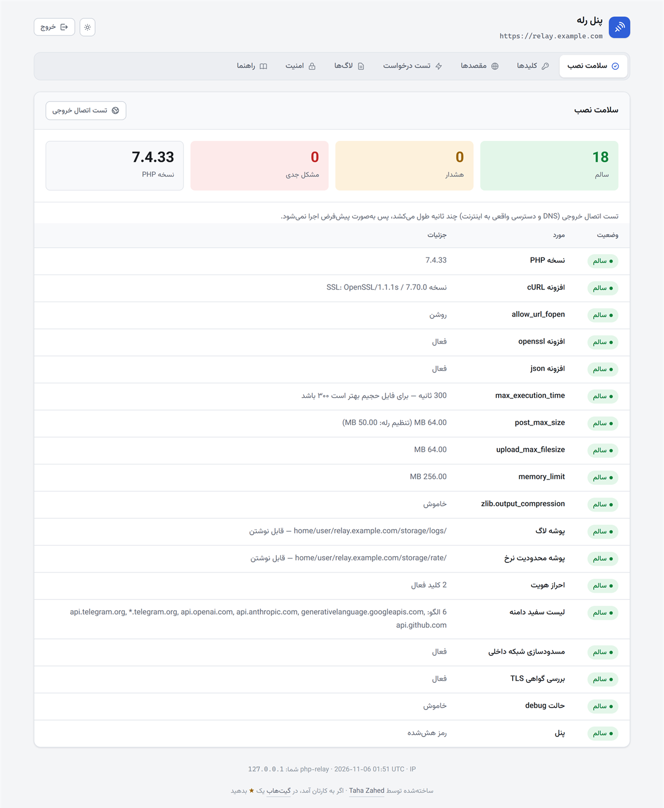
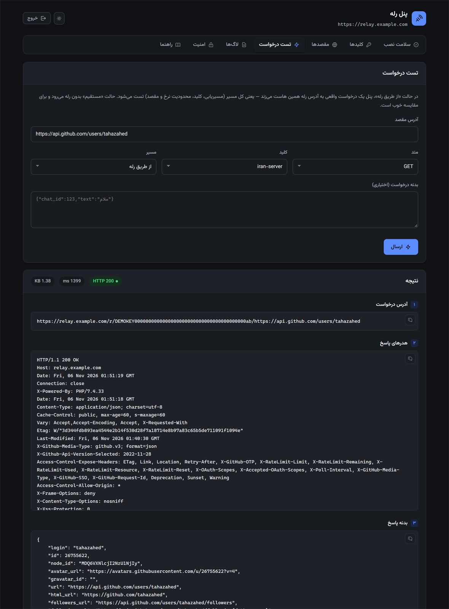
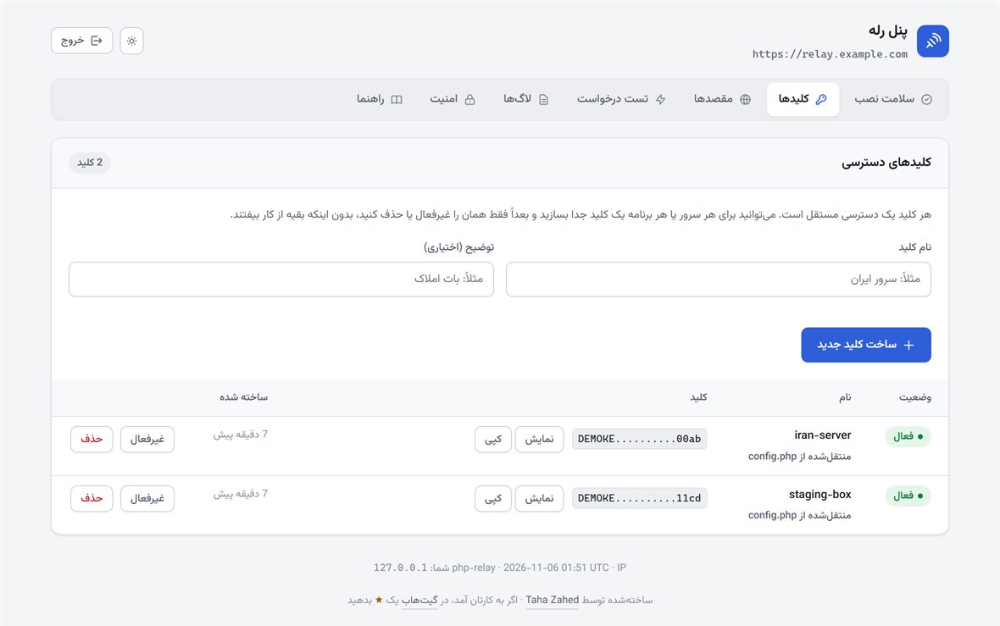
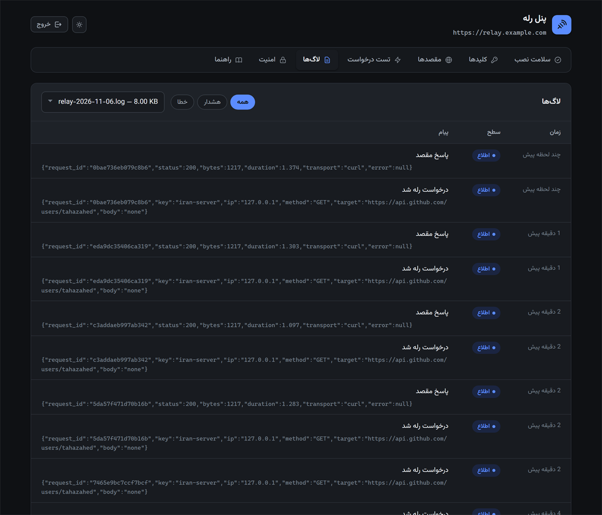

<div align="center">

# PHP Relay Proxy

**An HTTP relay you can drop onto any cPanel or DirectAdmin account.**
No Composer, no root, no Docker, no background workers — just PHP files in a `public_html`.

[](https://www.php.net/)
[](LICENSE)
[](#why-no-composer)
[](#web-server-compatibility)

[فارسی](README.fa.md) · [Deployment guide](docs/deployment-cpanel.md) · [Security policy](SECURITY.md)

</div>

---

## The problem this solves

I run a Telegram bot. The bot code lives on an Iranian shared host, because that is where
the database and the rest of the application already are. The trouble is that
`api.telegram.org` is unreachable from inside Iran, so every single call — `getMe`,
`sendMessage`, `sendPhoto` — dies with a connection timeout.

Moving the whole application abroad was not an option. Running a VPN or a SOCKS proxy on a
shared host is not an option either: no root, no daemons, no persistent processes.

What I did have was a cheap cPanel account on a German host. So I wrote this: a relay that
sits on the foreign host, accepts requests from the Iranian server, forwards them to the
real destination, and hands the response back untouched — byte for byte, headers, status
code and all.

```
 YOUR SERVER                      THE RELAY                     DESTINATION
  (blocked)                     (this script)              api.telegram.org
      |                               |                                   |
GET /r/<KEY>/https://api.telegram.org/bot<TOKEN>/getMe
      |------------------------------>|                                   |
      |                               |                                   |
                                              GET /bot<TOKEN>/getMe
      |                               |---------------------------------->|
      |                               |                                   |
                                                 200 OK  +  body
      |                               |<----------------------------------|
      |                               |                                   |
         the same 200, byte for byte
      |<------------------------------|                                   |
      |                               |                                   |
```

The application code changes by one line: the API base URL. Everything else — the bot
library, the request bodies, the file uploads — stays exactly as it was.

<div align="center">
  
  <br>
  <sub>The admin panel's health check, run against a fresh install.</sub>
</div>

---

## Concrete scenarios

A relay is boring on purpose: it moves an HTTP request from a server that cannot make it
to one that can. What changes between these cases is only *where you hook it in* — a base
URL, a framework filter, or one Guzzle middleware.

Every example below was run through this code against a real endpoint before it went in
the README.

### A Telegram bot whose code cannot be moved

Your bot runs on an Iranian host. Point its API base at the relay:

```php
// Before — times out from inside Iran
$api = 'https://api.telegram.org';

// After — goes out through the relay
$api = 'https://relay.example.com/r/' . RELAY_KEY . '/https://api.telegram.org';
```

Every method then works unchanged, including file uploads:

```php
// sendPhoto with a real multipart upload, straight through the relay
$response = relay_request(
    "https://api.telegram.org/bot{$token}/sendPhoto",
    'POST',
    [
        'chat_id' => 123456789,
        'caption' => 'Uploaded through the relay',
        'photo'   => new CURLFile(__DIR__ . '/sample.jpg', 'image/jpeg', 'sample.jpg'),
    ]
);
```

Most bot libraries expose the base URL as a setting, so there is usually nothing to patch.
In python-telegram-bot it is `base_url`; in Telegraf it is `telegram.apiRoot`; in
`irazasyed/telegram-bot-sdk` it is the `base_bot_url` config key.

Downloading files is a separate Telegram path, so it gets its own URL:

```
https://relay.example.com/r/<KEY>/https://api.telegram.org/file/bot<TOKEN>/<file_path>
```

**About incoming updates.** Telegram itself is not blocked — *your server* is the side that
cannot get out. So there are two ways back in:

- **`getUpdates` (long polling)** — the simplest. Your server starts the request, it goes
  through the relay, and Telegram answers. No webhook and no public domain needed. Set your
  client timeout above Telegram's own (65s against a 60s poll) and you are done.
- **Webhook** — if your Iranian domain is reachable from the outside, call `setWebhook`
  pointing at it. Telegram connects to you directly, so only the `setWebhook` call itself
  has to go through the relay.

A complete working example of both is in
[`clients/telegram-webhook.php`](clients/telegram-webhook.php). That file goes on your
*own* server, not on the relay.

### LLM APIs: OpenAI, Claude, Gemini

Same shape, different host. Add the domain to the allowlist and change the base URL:

```bash
curl "https://relay.example.com/r/<KEY>/https://api.openai.com/v1/chat/completions" \
     -H "Authorization: Bearer sk-..." \
     -H "Content-Type: application/json" \
     -d '{"model":"gpt-4o-mini","messages":[{"role":"user","content":"hello"}]}'
```

Streamed responses (`"stream": true`) work, because the relay streams the body out in
chunks instead of buffering it. A one-gigabyte download will not blow the memory limit
either.

### A WordPress site, without touching plugin code

This is the case where editing every call site is not realistic — the outbound requests
are buried inside themes and plugins you did not write. WordPress routes all of them
through one HTTP API, so you can redirect it from a single must-use plugin.

Save this as `wp-content/mu-plugins/relay.php` and nothing else changes:

```php
<?php
// wp-content/mu-plugins/relay.php — loads before regular plugins, cannot be deactivated

const RELAY_BASE  = 'https://relay.example.com';
const RELAY_KEY   = 'your-key';
const RELAY_HOSTS = ['api.telegram.org', 'api.openai.com', 'www.google.com'];

add_filter('pre_http_request', static function ($preempt, $args, $url) {
    static $busy = false;

    // the relayed call below re-enters this filter; the flag stops the recursion
    if ($busy || !in_array(parse_url($url, PHP_URL_HOST), RELAY_HOSTS, true)) {
        return $preempt;
    }

    $busy   = true;
    $result = wp_remote_request(RELAY_BASE . '/r/' . RELAY_KEY . '/' . $url, $args);
    $busy   = false;

    return $result;
}, 10, 3);
```

Returning a response array from `pre_http_request` short-circuits WordPress's own request,
so plugins get a normal `wp_remote_*` result and never learn a relay was involved.

### Laravel and Guzzle: one middleware, every call site unchanged

Same idea, different framework. A `mapRequest` middleware rewrites the URI of any request
headed for a blocked host:

```php
use GuzzleHttp\Client;
use GuzzleHttp\HandlerStack;
use GuzzleHttp\Middleware;
use GuzzleHttp\Psr7\Uri;
use Psr\Http\Message\RequestInterface;

$relayed = ['api.openai.com', 'api.telegram.org', 'api.stripe.com'];

$stack = HandlerStack::create();

$stack->push(Middleware::mapRequest(function (RequestInterface $request) use ($relayed) {
    if (!in_array($request->getUri()->getHost(), $relayed, true)) {
        return $request;
    }

    return $request->withUri(new Uri(
        config('relay.base') . '/r/' . config('relay.key') . '/' . $request->getUri()
    ));
}));

$client = new Client(['handler' => $stack]);
```

`withUri()` rewrites the `Host` header to the relay by default, which is what you want
here. In Laravel, hand the same stack to the HTTP client:

```php
Http::withOptions(['handler' => $stack])->post('https://api.openai.com/v1/chat/completions', $payload);
```

### Push notifications through Firebase

The detail people miss is that this needs **two** hosts on the allowlist, not one. Minting
the access token and sending the message are different Google services:

```
oauth2.googleapis.com     ← exchanges the service-account JWT for an access token
fcm.googleapis.com        ← actually sends the notification
```

```bash
# 1. get an access token
curl "https://relay.example.com/r/<KEY>/https://oauth2.googleapis.com/token" \
     -d "grant_type=urn:ietf:params:oauth:grant-type:jwt-bearer&assertion=<SIGNED_JWT>"

# 2. send to a device
curl "https://relay.example.com/r/<KEY>/https://fcm.googleapis.com/v1/projects/<PROJECT>/messages:send" \
     -H "Authorization: Bearer <ACCESS_TOKEN>" \
     -H "Content-Type: application/json" \
     -d '{"message":{"token":"<DEVICE>","notification":{"title":"سلام","body":"یک پیام تازه"}}}'
```

The colon in `messages:send` survives the trip, and so does the UTF-8 — a JSON body with
Persian text comes out the far side byte for byte.

### Verifying reCAPTCHA server-side

A contact form on a blocked server cannot validate its own captcha, because the check is
a server-to-server POST to Google that times out. The form then either rejects every
legitimate submission or gets configured to skip validation, which defeats the point.

```bash
curl -X POST "https://relay.example.com/r/<KEY>/https://www.google.com/recaptcha/api/siteverify" \
     -d "secret=<SECRET>&response=<TOKEN_FROM_BROWSER>&remoteip=<USER_IP>"
```

Allowlist `www.google.com` and the form works again.

**One honest caveat:** this fixes the server half only. Your visitor's browser still has to
load the reCAPTCHA widget itself. If your users are also behind the blocking, a server-side
relay does not help them — use a captcha whose assets they can actually reach.

### Payment, SMS and email providers

All the same shape: add the host to the allowlist, put the relay in front of the base URL.

| Service | Host to allowlist |
|---|---|
| Stripe | `api.stripe.com` |
| PayPal | `api-m.paypal.com` |
| Twilio | `api.twilio.com` |
| SendGrid | `api.sendgrid.com` |
| Mailgun | `api.mailgun.net` |

**Webhooks are the other direction.** The relay handles your server calling out. A provider
calling *in* to tell you a payment succeeded still needs your server to be reachable from
the internet — or you poll for status instead, the same trade-off as `getUpdates` versus a
Telegram webhook.

### Keeping API keys off the application server

If your Iranian server is ever compromised, any API key stored in its code goes with it.
You can keep the key on the relay instead:

```php
// config.php, on the relay only
'http' => [
    'extra_request_headers' => [
        'Authorization' => 'Bearer sk-proj-...',
    ],
],
```

The application server now sends requests without the key and the relay injects it on the
way out. The application only holds the relay key, which you can revoke from the panel in
two clicks without touching the upstream account.

### GitHub, Composer and npm

```bash
curl "https://relay.example.com/r/<KEY>/https://api.github.com/repos/laravel/laravel/releases/latest"
```

Useful for update checks, CI scripts and licence servers on machines that cannot reach
`api.github.com` or `registry.npmjs.org` directly.

### Where this approach runs out

Worth knowing before you build on it:

- **WebSockets do not work.** A PHP script on shared hosting cannot hold a bidirectional
  connection open. There is no workaround here; you need a different kind of host.
- **Inbound traffic is not covered.** This is an outbound relay. Anything that has to
  reach *you* — webhooks, callbacks, OAuth redirects — still needs a reachable server, or
  a polling design instead.
- **Host-bound request signatures need testing.** Schemes that sign the `Host` header or
  the full URL, AWS Signature V4 being the common one, are sensitive to a request being
  re-issued. Try it against your actual provider before you depend on it.
- **Browser-side blocking is a separate problem.** If your visitors cannot load a script
  or widget, relaying your server's calls changes nothing for them.
- **You are adding a hop.** Expect the extra round trip to your relay host on every call.

---

## What it supports

| Capability | |
|---|---|
| All HTTP methods (`GET`/`POST`/`PUT`/`PATCH`/`DELETE`/`HEAD`/`OPTIONS`) | yes |
| JSON, form and raw binary bodies, byte-exact | yes |
| `multipart/form-data` uploads (`sendPhoto`, `sendDocument`, …) | yes |
| Large uploads streamed, never buffered in memory | yes |
| Large downloads streamed out chunk by chunk | yes |
| `Transfer-Encoding: chunked` request bodies | yes |
| Headers and status codes passed through verbatim | yes |
| Redirects followed, with every hop re-validated | yes |
| Fixed-key or HMAC-signed authentication | yes |
| Host allowlist, rate limiting, logging, CORS | yes |
| SSRF protection (private ranges blocked, DNS pinning) | yes |
| Admin panel with a live request tester and log viewer | yes |
| Works without the cURL extension (stream wrapper fallback) | yes |
| WebSocket | no — not possible with PHP on shared hosting |

---

## Requirements

- PHP 7.4 or newer. CI syntax-checks every push against 7.4, 8.0, 8.1, 8.2 and 8.3; the
  install I run day to day is on 8.1.
- The `curl` extension — optional but strongly preferred. Without it the relay falls back
  to stream wrappers, which are slower and need `allow_url_fopen` on.
- `openssl` and `json`
- A hosting account that is not subject to the same blocking as your application server
- Write access to `storage/logs` and `storage/rate`

That is the whole list. No shell access, no cron job, no Composer, no database.

---

## Installation, step by step

This section assumes you have never deployed anything by hand before. If you are in a
hurry, steps 1, 2, 4 and 7 are the ones that matter.

### Step 1 — Get a hosting account that is not blocked

Any shared cPanel or DirectAdmin account outside the blocked region works. You do not need
a VPS. Point a domain or subdomain at it, for example `relay.yourdomain.com`, and let the
panel issue a free Let's Encrypt / AutoSSL certificate. **Use HTTPS** — the relay key
travels in the URL, and plain HTTP would expose it.

### Step 2 — Upload the files

Download this repository (green **Code** button → **Download ZIP**), then in cPanel open
**File Manager**, go to the document root of your subdomain, upload the ZIP, and use
**Extract** from the right-click menu.

When you are done the directory should look like this:

```
public_html/              ← document root of relay.yourdomain.com
├── index.php             ← entry point; every relayed request lands here
├── panel.php             ← admin panel
├── bootstrap.php
├── config.php            ← you create this in step 3
├── config.sample.php
├── .htaccess
├── src/                  ← the implementation
├── tools/                ← keygen and self-test
├── clients/              ← example code for YOUR server, not for the relay
├── assets/               ← the panel's font
└── storage/
    ├── logs/
    └── rate/
```

You do not need to upload `docs/` or the README files. They do no harm either.

### Step 3 — Create `config.php`

In File Manager, right-click `config.sample.php` → **Copy**, and name the copy
`config.php`. Every setting is documented inline in that file.

> **Safer alternative.** If you can create directories one level above the document root,
> put the file in `../relay-private/config.php` instead. `bootstrap.php` looks there first.
> The reason: if your host's PHP handler ever breaks, a `config.php` inside the document
> root gets served as plain text, keys and all. Outside the web root it cannot be.

### Step 4 — Generate a key and a password hash

If you have SSH or cPanel's Terminal:

```bash
php tools/keygen.php "the-panel-password-you-want"
```

That prints an access key, an HMAC secret, and a bcrypt hash of your panel password.

No terminal? Open `https://relay.yourdomain.com/panel.php`, log in with the temporary
password from `config.php`, and use the **Keys** tab — it generates keys for you. For the
password hash, the **Security** tab will hash a new password with no command line at all.

### Step 5 — Edit `config.php`

Four things matter. Everything else has a sensible default.

```php
'auth' => [
    'keys' => [
        // one key per client, so you can revoke them one at a time
        'my-server' => 'the-key-from-step-4',
    ],
],

'target' => [
    // ONLY the domains you actually need. Never leave this empty.
    'host_allowlist' => ['api.telegram.org', '*.telegram.org'],
],

'panel' => [
    'password_hash' => 'the-bcrypt-hash-from-step-4',
    'password'      => '',   // leave empty once the hash is set
],

'app' => ['debug' => false],
```

### Step 6 — Fix folder permissions

`storage/logs` and `storage/rate` have to be writable. `755` is usually enough; if logging
stays empty, try `775`.

### Step 7 — Verify the install

Open `https://relay.yourdomain.com/panel.php` and look at the **Health** tab. Every row
should be green. Anything marked FAIL needs fixing before you rely on this.

From a terminal the same check is:

```bash
php tools/selftest.php
```

Then use the **Request test** tab to fire a real request and watch the response come back:

<div align="center">
  
  <br>
  <sub>A real request through the relay — status, timing, response headers and body.</sub>
</div>

### Step 8 — Point your application at it

Replace the API base URL in your application, as shown in the scenarios above.
[`clients/php-client.php`](clients/php-client.php) is a ready-made wrapper you can copy.

---

## Addressing modes

There are four ways to say "relay this". They all do the same thing, so pick whichever fits
the library you are using.

### Key in the path (recommended)

```
https://relay.example.com/r/<KEY>/https://api.telegram.org/bot<TOKEN>/getMe
```

This is the only mode that works with libraries that will not let you add custom headers.

> The target URL **must** start with `https://` or `http://`. Without a scheme the script
> cannot tell where the key ends and the target begins.

### Key in a header

```bash
curl "https://relay.example.com/r/https://api.telegram.org/bot<TOKEN>/getMe" \
     -H "X-Relay-Key: <KEY>"
```

### Everything in the query string

```
https://relay.example.com/?relay_url=https%3A%2F%2Fapi.telegram.org%2Fbot<TOKEN>%2FgetMe&relay_key=<KEY>
```

Useful when a host's mod_security rejects URLs containing `https://` in the path.

### Target in a header

```bash
curl https://relay.example.com/ \
     -H "X-Relay-Key: <KEY>" \
     -H "X-Relay-Target: https://api.telegram.org/bot<TOKEN>/getMe"
```

---

## Web server compatibility

Short version: **any cPanel or DirectAdmin account works.** Longer version:

| Setup | Works | Notes |
|---|---|---|
| Apache with `mod_rewrite` | yes | The default. Nothing to do. |
| LiteSpeed / LiteSpeed Enterprise | yes | Reads the same `.htaccess` with the same syntax. This is what most cPanel hosts actually run today. |
| nginx in front of Apache (cPanel) | yes | nginx is only a reverse-proxy cache there; Apache still applies `.htaccess`. |
| Apache **without** `mod_rewrite` | yes | Use the `index.php` form below. |
| Standalone nginx or Caddy (no cPanel) | yes, manually | You write the rewrite rule yourself; see below. |

The whole rewrite block lives inside `<IfModule mod_rewrite.c>`, so if the module is
missing it is skipped silently rather than throwing a 500. You then address the relay like
this:

```
https://relay.example.com/index.php/r/<KEY>/https://api.telegram.org/bot<TOKEN>/getMe
```

That form works because the path is read from `REQUEST_URI` with `SCRIPT_NAME` stripped off
the front, not from `PATH_INFO` — web servers normalise `PATH_INFO` and would collapse the
`//` inside the target URL.

For standalone nginx, this is the equivalent of the shipped `.htaccess`:

```nginx
location / {
    try_files $uri $uri/ /index.php$is_args$args;
}

location ~ ^/panel\.php$ {
    include        fastcgi_params;
    fastcgi_pass   unix:/run/php/php8.1-fpm.sock;
    fastcgi_param  SCRIPT_FILENAME $document_root/panel.php;
}
```

**One gotcha.** On hosts that do not allow `AllowOverride Options`, the
`Options -Indexes -MultiViews` line at the top of `.htaccess` causes a 500 on every
request. Delete that one line and everything else keeps working.

---

## The admin panel

`https://relay.example.com/panel.php`

| Tab | What it does |
|---|---|
| Health | PHP version, extensions, limits, folder permissions, and an outbound connectivity test (behind a button, because it is slow) |
| Keys | Create, disable and delete access keys without touching a file |
| Targets | Toggle the host allowlist and edit the list of permitted domains |
| Security | Change the panel password, recover a forgotten one, restrict the panel to one IP |
| Request test | Fire a real request through the relay (or directly, for comparison) and inspect headers and body |
| Logs | The last 200 records, filterable by level, with relative timestamps |
| Guide | Copy-ready URLs for each addressing mode |

<div align="center">
  
  <br>
  <sub>Keys are masked by default and revealed only on demand. One key per client means you can revoke one without breaking the others.</sub>
</div>

<div align="center">
  
  <br>
  <sub>Every request gets an id that also comes back in the <code>X-Relay-Request-Id</code> response header, so you can find the exact record later.</sub>
</div>

The panel makes **no external requests at all.** The Vazirmatn font is served from this
host's own `assets/` folder, not from Google Fonts or a CDN. That is deliberate: the panel
is often opened from inside a network where CDNs are not reachable either.

Light and dark follow the system setting, with a manual toggle that persists in
`localStorage`.

If you do not want a panel at all, set `panel.enabled` to `false` or just delete the file.

### Keys and targets live in `settings.json`

Keys and the allowlist are stored in `settings.json`, written next to `config.php` — which
means outside the document root if you followed the advice in step 3. Only the panel writes
it, and the file is created with mode `0600`.

On first run, `auth.keys` and `target.host_allowlist` are migrated out of `config.php` into
`settings.json`. **After that, `settings.json` wins** and editing those two keys in
`config.php` has no effect. This is intentional: otherwise a key you deleted in the panel
would come back to life from `config.php` on the next deploy.

Forgot the panel password? Open `settings.json` and blank out `panel.password_hash`. The
`config.php` password becomes valid again.

---

## Security

This script makes outbound requests to URLs it is told to fetch. Left unprotected that is
an open proxy, and an open proxy on a shared host gets the account suspended. These
defences are on by default:

| Protection | What it does |
|---|---|
| Mandatory key | Without a valid key the request never reaches DNS resolution |
| Host allowlist | `target.host_allowlist` — **do not leave this empty** |
| Private network blocking | `127.0.0.1`, `10.x`, `192.168.x`, `169.254.169.254` (cloud metadata) and the IPv6 equivalents |
| DNS pinning | The host is resolved once and that IP is handed to cURL, which defeats DNS rebinding |
| Per-hop redirect validation | A redirect into a disallowed host or a private range is refused |
| Scheme and port limits | `http`/`https` only, on permitted ports |
| `user:pass@host` rejected | Closes a classic way of fooling host checks |
| Header injection guard | CR/LF stripped from header values |
| Rate limiting | File-based sliding window, keyed by access key and IP |
| Log redaction | Bot tokens and API keys are written as `[REDACTED]` |

### Worth doing as well

- Keep `app.debug` off in production. With it on, error details go back in the response.
- If your application server has a static IP, lock `auth.ip_allowlist` to it. This is the
  single strongest control available here: it makes a leaked key useless from anywhere
  else.
- If a fixed key is not enough, turn on `auth.hmac`. Signatures expire after a few minutes
  and cannot be replayed:

  ```php
  $ts  = time();
  $sig = hash_hmac('sha256', "GET\n{$targetUrl}\n{$ts}", $secret);
  // send as X-Relay-Timestamp and X-Relay-Signature
  ```

See [SECURITY.md](SECURITY.md) for how to report a vulnerability.

---

## Configuration

Every key is documented inline in [`config.sample.php`](config.sample.php). The ones that
come up most often:

| Key | Default | Purpose |
|---|---|---|
| `http.timeout` | `120` | Total time budget for one request |
| `http.max_request_body` | `50MB` | Upload ceiling |
| `http.max_response_body` | `0` | Download ceiling (`0` = unlimited) |
| `http.stream_upload_threshold` | `2MB` | Bodies above this are streamed instead of buffered |
| `http.max_redirects` | `3` | Redirect hops allowed |
| `http.verify_tls` | `true` | Verify the destination's certificate |
| `http.ca_bundle` | `null` | Path to `cacert.pem` if the host's CA store is stale |
| `http.send_forwarded_headers` | `false` | Forward the client IP to the destination |
| `rate_limit.max_requests` | `300` | Requests per window |
| `log.log_bodies` | `false` | Store bodies in the log (may capture sensitive data) |
| `log.max_records` | `2000` | Record ceiling per log file (`0` = no limit) |
| `log.max_files` | `7` | How many daily log files to keep |
| `rewrite.enabled` | `false` | Rewrite destination URLs inside response bodies |

### Why the log truncates to 80%, not to the limit

A busy proxy generates log lines fast, so each daily file is capped at `log.max_records`.
When it hits the cap it is trimmed back to **80%** of it, dropping the oldest records.

The 20% gap is deliberate. Trimming exactly to the cap would mean the very next write
exceeds it again, so every single request would rewrite the whole file. Measured, that
takes a write from 0.33 ms to 12 ms. With the gap, trimming happens once per 20% of
capacity and the amortised cost comes to 0.17 ms per write.

Deciding *when* to trim costs nothing either: the size of the record just written is used
as the average-record estimate (records are uniform), and a cheap `stat` gives the file
size. The trim itself is exact; the estimate only affects timing.

With the defaults, worst case is roughly `2000 × 7 × ~250 bytes`, so about 3.5 MB of logs.

---

## Troubleshooting

| Symptom | Cause and fix |
|---|---|
| `500` on every path | Almost always `.htaccess`. If your host disallows `Options`, delete the `Options -Indexes -MultiViews` line. |
| `404` on `/r/...` but `/index.php/r/...` works | `mod_rewrite` is off. Use the `index.php` form, or ask support to enable it. |
| `403 host_not_allowed` | The destination is not in `target.host_allowlist`. |
| `403 private_network_blocked` | The target resolves to a private IP. For local testing only, set `block_private_networks` to `false`. |
| `502 unable to get local issuer certificate` | The host's CA bundle is out of date. Download `cacert.pem` from [curl.se/ca](https://curl.se/ca) and set `http.ca_bundle`. |
| `502 self signed certificate` | Something is intercepting TLS. If you see this on your *application* server, the request never reached the relay. |
| `413 request_too_large` | Raise `http.max_request_body`, and the host's `post_max_size` / `upload_max_filesize`. |
| Large uploads cut off halfway | Raise `max_execution_time` and `http.timeout`. |
| `429` | Raise `rate_limit.max_requests`. |
| Requests with `https://` in the path are blocked | Host-level mod_security. Use the query-string mode, or ask support to relax the rule for your domain. |
| Log file stays empty | `storage/logs` is not writable. |

Every response carries an `X-Relay-Request-Id` header. Use it to find the exact record in
the log.

---

## How it works internally

### Why no Composer

Shared hosting control panels rarely give you a shell, and `composer install` needs one.
Requiring it would have ruled out exactly the hosts this is built for. So there is a
twenty-line autoloader in `bootstrap.php` and nothing else. There is no `vendor/` directory
and nothing to keep updated.

### Streaming, properly

Responses are emitted chunk by chunk as they arrive, so a one-gigabyte download does not
touch the memory limit. To make that work, `zlib.output_compression` is disabled and every
output buffer is closed before the first byte goes out.

### Rebuilding multipart bodies

On PHP-FPM and LSAPI, PHP parses `multipart/form-data` itself and leaves `php://input`
empty. When that happens the relay reconstructs the body from `$_POST` and `$_FILES`,
including nested fields like `reply_markup[inline_keyboard][0][0][text]` that Telegram
relies on.

### Redirects, by hand

Redirects are followed manually rather than by cURL, so every hop goes back through the
security filter. `301`/`302`/`303` downgrade the method to `GET` per RFC; `307`/`308` are
*not* followed when the body was streamed, because it cannot be rewound, and the redirect
is handed to the client instead.

The `Location` header of a 3xx response is rewritten to point back at the relay, so the
client does not get sent straight to the blocked domain.

### Other details

- `Content-Length` passes through untouched, since the bytes are untouched — unless the
  body rewriter changed something, in which case it is recalculated.
- Cookies pass through, but a `Set-Cookie` issued for the destination's domain will not be
  accepted by a browser on the relay's domain. For APIs this does not matter.

---

## Project layout

| Path | Role |
|---|---|
| `index.php` | Entry point |
| `bootstrap.php` | Autoloader and configuration loading |
| `config.sample.php` | Fully commented configuration template |
| `src/Proxy.php` | The core: validate, send, follow redirects, respond |
| `src/Settings.php` | Panel-editable keys and targets (`settings.json`) |
| `src/TargetResolver.php` | Extracting and validating the destination URL |
| `src/Auth.php` | Keys, HMAC, IP allowlist |
| `src/RequestBody.php` | Incoming body: string, stream, or rebuilt multipart |
| `src/Headers.php` | Header filtering both ways, plus CORS |
| `src/Transport/CurlTransport.php` | Primary transport, bidirectional streaming |
| `src/Transport/StreamTransport.php` | Fallback for hosts without cURL |
| `src/RateLimiter.php` | File-based rate limiting |
| `src/Logger.php` | JSON Lines logging with redaction |
| `src/Emitter.php` | Writing the response to the client |
| `src/BodyRewriter.php` | Optional URL rewriting inside response bodies |
| `panel.php` | Admin panel |
| `tools/selftest.php` | Health check, CLI and panel |
| `tools/keygen.php` | Key and password-hash generator |
| `clients/` | Example code for your own server |
| `assets/` | Vazirmatn variable font and its SIL OFL licence |

---

## Before you rely on it

- [ ] `config.php` exists and the sample key is gone
- [ ] `target.host_allowlist` contains only what you need
- [ ] `app.debug` is `false`
- [ ] The panel password is a hash, or the panel is disabled
- [ ] `auth.ip_allowlist` is locked to your server, if it has a static IP
- [ ] `php tools/selftest.php` reports no FAIL
- [ ] A real request came back `200` from the **Request test** tab

---

## Contributing

Bug reports and pull requests are welcome — see [CONTRIBUTING.md](CONTRIBUTING.md). The one
hard rule is that it has to keep working on a plain shared host with no shell: no Composer
dependencies, no build step, PHP 7.4 compatible.

## Licence

[MIT](LICENSE). The bundled Vazirmatn font is under the
[SIL Open Font Licence](assets/Vazirmatn-OFL.txt).

## Author

Built by **Taha Zahed** — [github.com/tahazahed](https://github.com/tahazahed)

If this saved you an afternoon, a ⭐ on the repository is genuinely appreciated. It is the
main way other people find it.
